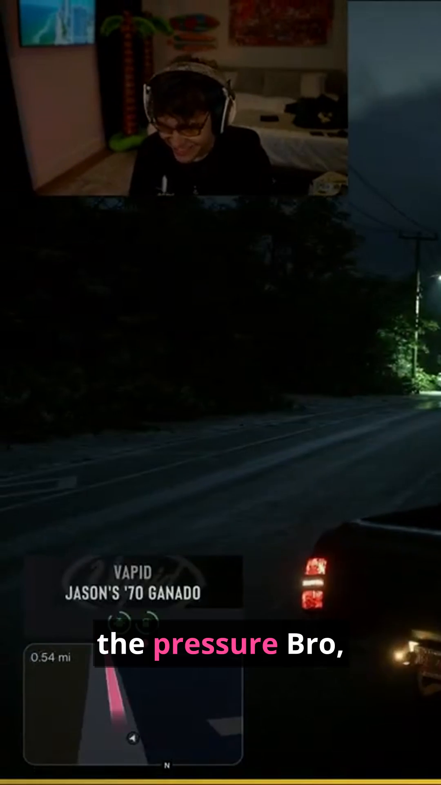

# Leonida Clipper Pro

Free, local, no-API-key video clipper for Leonida Nights. Paste a YouTube
link (or drop a local video file) and get scored, captioned, vertical
**60-second** clips back — 1080×1920, true 9:16 crop, no watermark, nothing
uploaded to any server.

Based on **Chopify by Mehbul Islam** ([mehbul/chopify](https://github.com/mehbul/chopify)),
MIT licence — see `LICENSE`. Leonida Clipper Pro adapts Chopify's heuristic
clip scoring (transcript + audio + visual evidence), caption burning, and
yt-dlp ingest, with Leonida Nights defaults baked in.

> **ClipCutter swap-in pending:** a parallel test of ClipCutter / Clipwise
> (free repos that also accept a YouTube link) was still running when this
> was built. If that test names a better winner, this project may swap its
> scoring/ingest for that repo's — see
> `~/workspace/local-clipper-test/YOUTUBE-LINK-CLIPPER.md` when it lands.

## What it does

1. **Ingest** — a YouTube link via yt-dlp, or a local MP4/MOV/MKV/WebM file.
2. **Transcribe** — Faster-Whisper, locally on CPU (base model by default).
3. **Score** — heuristic scoring from the transcript, a 1 Hz audio timeline
   (loudness / peaks / transients) and 2 fps visual analysis (motion, scene
   cuts, faces). No LLM, no API key, no Ollama needed. Silent / visual
   gameplay moments still score from audio + visual evidence.
4. **Render** — ffmpeg, true 9:16 `cover` crop (no blurred background, no
   stacked facecam layout by default), word-by-word burned-in captions,
   plus `.srt`, poster and `.meta.json` per clip.

## Leonida Nights spec (the `--leonida` preset)

- Exactly **60.00 s** per clip — discovery looks for natural 50–70 s
  windows, then each pick is windowed to exactly 60.00 s at render time
  (plus a post-trim safety net if a render ever runs long)
- **1080×1920**, 9:16, `fit cover`, single layout
- Whisper `base`, CPU, minimum score **7.0**
- No API key, no Ollama, no watermark, no upload anywhere

## Install

Python 3.11+, ffmpeg (with libx264 + AAC) on PATH.

```bash
git clone https://github.com/leonidanights07/leonida-clipper-pro.git
cd leonida-clipper-pro
python3 -m venv .venv
.venv/bin/python -m pip install -r requirements.txt
```

Or one command: `./install.sh` (macOS/Linux) / `install.ps1` (Windows).

## Use

```bash
# Leonida preset, YouTube link (only creators who gave permission to clip)
.venv/bin/python leonida.py --leonida --no-input \
  "https://www.youtube.com/watch?v=LwJEFow3ccE" \
  --max-clips 3 --out clips

# Local file instead of a link
.venv/bin/python leonida.py --leonida --no-input \
  /path/to/source.mp4 --max-clips 3 --out clips

# Local dashboard (same engine, browser UI)
.venv/bin/python dashboard.py
# open http://127.0.0.1:8765
```

Clips land in `clips/` (or `--out`). Each clip is verified with
`ffprobe` before use: duration 60.00 s, 1080×1920, H.264 + AAC.

## Subtitles — burned in, word by word

Every clip gets burned-in, word-by-word subtitles from the local Whisper
transcript it already makes — no API key, no paid service, nothing uploaded.
The captions are rendered into the video with ffmpeg's ASS engine, and a
matching `.srt` file is exported next to each clip. Captions sit at the
**bottom** of the 9:16 frame, in large bold type with a black outline (and a
dark box on the Leonida style) so they stay readable on bright gameplay.



### Subtitle styles — pick one per clip, in the dashboard

After clips are detected, each clip card in Leonida Studio shows a
**Subtitle style** picker with a preview (use the clip's ▶ Watch button —
it renders a 480p preview with that clip's chosen style). Pick a style for
each clip before you export; the choice is stored per clip and used when
the captions are burned in at export time. If you don't pick, the clip
uses the **Neon pink Leonida Nights** style.

| # | Style | Look |
|---|-------|------|
| 1 | Bold yellow word-pop (`hormozi`) | Big bold words, 2 per cue, active word pops in colour. Loud and punchy. |
| 2 | White bold, black outline (`default`) | Classic white bold words, black outline, yellow active word, 3 per cue. Clean on any background. |
| 3 | Karaoke word-by-word (`karaoke`) | Colour changes word by word as each word is spoken, 4 words per cue. |
| 4 | Minimal clean lower-third (`minimal`) | Lighter words on a dark lower-third box, 5 per cue. Quiet, stays out of the way. |
| 5 | Neon pink Leonida Nights (`leonida`) | **House style / default.** White bold words, neon-pink active word, dark box so captions stay readable on bright gameplay. |

From the command line the style is global for the run instead:
`--style hormozi` (or any of the 13 presets — see
`--list-styles`); `--leonida` uses the Neon pink Leonida Nights style.

### Profanity in subtitles

Subtitles are burned in **exactly as spoken** — nothing is silently
censored. If a clip's transcript contains profanity, it will appear in the
captions, so check the `.srt` / preview before the clip goes to Drive, the
Sheet, or YouTube. Uzair decides profanity handling per clip (keep, cut,
or drop the clip) — the tool does not decide for him.

## Rules — read this before you clip

- **Only clip creators who gave permission** — a live Content Rewards
  campaign, or the creator's own permission. Never clip a creator whose
  permission you cannot verify. Leonida Nights has not joined every
  campaign yet; joining is a separate step.
- **No religious point of view and no adult scenes** in any clip — check
  every clip (frames + captions) before it goes to Drive, the Sheet, or
  YouTube. Captions burn in whatever was said, including profanity — a
  clip with heavy profanity needs a human call first.
- This tool does not grant permission. It only cuts faster.

## What was fixed vs Chopify

- **CLI defaults bug** — Chopify built its options from argparse with
  `getattr(args, k, None)`, so flags with no CLI value became `None` and
  overrode the real defaults, failing validation one key at a time
  ("Fit must be cover or contain" → "facecam_height …" → …). This copy
  starts from `DEFAULT_OPTIONS` and overrides only with values actually
  given on the command line.
- **`av` dependency clash** — unpinned `requirements.txt` installed
  `av` 19, which breaks faster-whisper 1.2.1. Pinned `av==13.1.0`.
- **Exact 60 s** — discovery over 50–70 s windows, `projects.exact_window()`
  windows each pick to exactly 60.00 s at render time, `enforce_exact_60()`
  post-trim in `leonida.py` as a safety net.

## Long videos — chunked loading (30 minutes at a time)

Stream VODs are 8–10 hours; downloading and transcribing the whole thing
before the first clip appears is too slow. URL videos longer than 30
minutes are now discovered one slice at a time:

- **Prepare loads only the first 30 minutes** and shows its clips.
- A **"Load next 30 minutes"** button appears while more video remains
  (labelled with the time range, e.g. `Load next 30 minutes · 00:30–01:00`).
  Each click downloads, transcribes and scores only that slice
  (`yt-dlp --download-sections` — the rest of the file is never fetched)
  and **adds** its clips to the project; earlier clips stay. All clip times
  are global video times.
- When the last slice is loaded the button disappears.
- Videos of 30 minutes or less, and local files, work exactly as before —
  no button, no chunking.

`LEONIDA_CHUNK_SECONDS` overrides the slice length (tests use 120 s);
the default is 1800 s. Silent URL videos (no audio track) keep the old
whole-video path.

## Thumbnails — v4 style, three sizes

Every rendered clip can get a thumbnail in the Leonida Nights v4 style
(sunset background, circular logo on top, laptop mockup showing a frame
from the clip, big bold two-line text): **9:16** `1080×1920` (Shorts),
**16:9** `1920×1080` (standard YouTube), **1:1** `1080×1080` (square).
In the dashboard, the **Thumbnails** panel under the rendered clips lets
you pick a clip (text defaults from its hook), edit the two lines, tick
the sizes (all three on by default), and optionally give your own logo
image (local file path) or your own name text instead of a logo — with
nothing filled in, the Leonida Nights logo is used. Files are saved next
to the clip (`<clip>-thumb-9x16.jpg`, …). CLI:
`python thumbnails.py clip.mp4 --line1 "NEEDS KEYS!" --line2 "CAN'T STEAL IT!"`.

## What was left out (deliberately)

Live clipping, campaign-brief parsing, Ollama / semantic search, podcast
split-screen, and the heavy torch stack. None of those fit the Leonida
Nights workflow (local file / YouTube link in, 60 s vertical clip out).

## Licence

MIT — see `LICENSE` (Chopify, Copyright (c) 2026 Mehbul Islam).
Leonida Clipper Pro adaptations are also released under the MIT licence.
